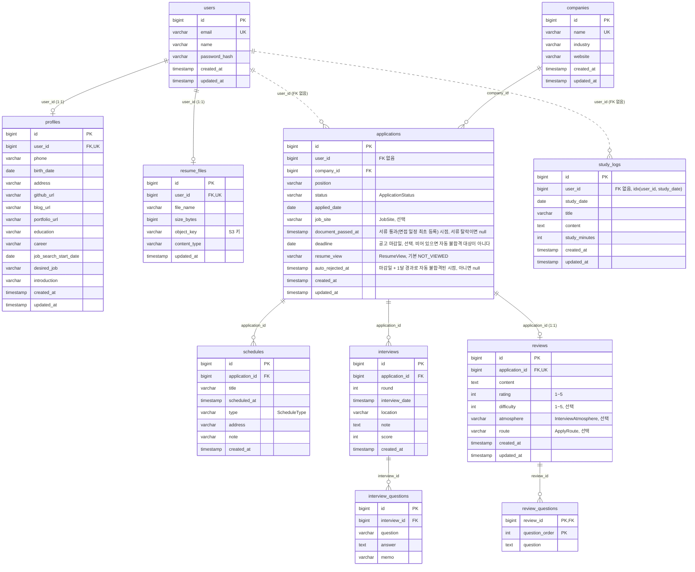

# ERD

운영 DB(PostgreSQL) 테이블 구성. 엔티티가 바뀌면 이 문서도 같은 커밋에서 고친다 (`.claude/hooks/erd-guard.py`가 확인한다).

## 참고

- `applications.user_id`, `study_logs.user_id`는 값 컬럼이고 DB FK가 없다. 소유자 검증은 서비스에서 한다.
- `profiles`는 `PersonalInfo`(@Embeddable)가 같은 테이블에 펼쳐진 구조다.
- `review_questions`는 `Review.questions`(@ElementCollection)의 컬렉션 테이블이고, `question_order`는 @OrderColumn이다.
- 마이그레이션 도구가 없고 `ddl-auto: update`는 컬럼 추가만 하므로, 변경 사항은 운영 DB에 DDL로 직접 반영해야 할 수 있다.
- `applications.resume_view`는 `not null default 'NOT_VIEWED'`로 추가되어 기존 행이 미열람으로 채워진다.
- 2026-11-10 코드 패키지를 `com.jobtracker`에서 `com.ssangtteongnip`으로 바꿨다. 엔티티 11개가 `package`와 `import` 줄만 바뀌었고 테이블, 컬럼, 관계는 그대로다.
